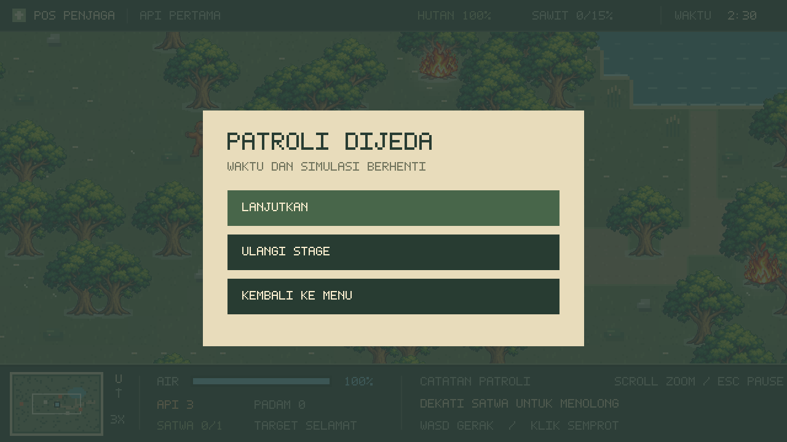
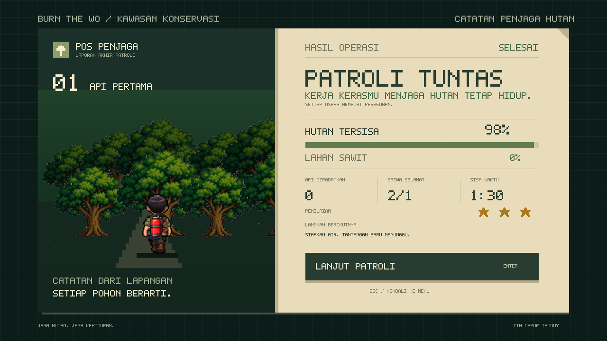
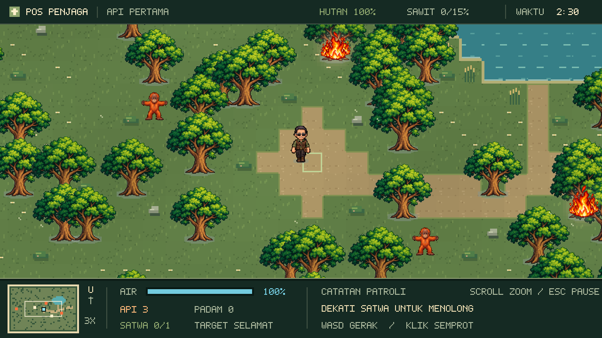

# Iterasi 11 — Ringkasan implementasi

Implementasi berada pada branch `feat/iteration-11-ui-audio-balancing`, berbasis `main` `0431f95`. Perubahan mencakup patch Iterasi 11 yang diberikan pengguna dan dukungan build Linux lokal yang sebelumnya belum di-commit.

## Fitur

1. **Pause/resume (Esc):** timer, pemain, air, entity, AI, dan perubahan peta berhenti selama pause.
2. **Panel pause:** Lanjutkan, Ulangi Stage, Kembali ke Menu; mendukung klik, panah/W/S, Enter/Spasi. Retry mempertahankan stage dan mereset timer/air.
3. **Audio pause:** musik/ambience loop berhenti pada posisi playback saat ini dan berlanjut setelah resume; one-shot UI tetap berjalan.
4. **Rating hasil:** kalah mendapat 0 bintang; menang minimal 1. Dua bintang memerlukan hutan ≥85% dan ≥75% seluruh satwa selamat. Tiga bintang memerlukan hutan ≥95% dan seluruh satwa selamat.
5. **Animasi bintang:** muncul berurutan dengan SFX pada laporan hasil. Total populasi satwa dipisahkan dari target minimum menang saat menghitung rating.
6. **SFX peristiwa:** panik per spesies, rescue, satwa terbakar, sabotase api/penanaman, boss muncul, pause/resume, dan bintang.
7. **Pencarian aset:** PNG, WAV, varian SFX, dan narasi memakai resolver bersama, memprioritaskan aset dekat executable lalu fallback folder kerja. Header SDL tetap privat di Engine.
8. **Konfigurasi:** parameter rescue, paparan api, kecepatan satwa/musuh, dan hadangan dipusatkan di `GameConfig.h`. Nilai baseline dipertahankan; belum ada tuning berdasarkan playtest manusia.
9. **Dokumentasi:** kontrol, hasil pengujian, dan status implementasi diperbarui.

Dukungan lokal yang ikut disertakan: CMake C++20, `run.sh`, libpng Linux yang telah disetujui pengguna, dan penyesuaian include agar build Windows tetap memakai WIC. Aplikasi desktop lokal telah diperbarui ke build Release. Tidak ada engine/framework pihak ketiga yang ditambahkan.

## Screenshot dari renderer game

### Pause pada stage berjalan

### Rating hasil — data uji

Data fixture: 98% hutan, dua satwa selamat, target minimum satu, waktu tersisa 1:30. Ini bukti tampilan/animasi rating, bukan kemenangan sesi pemain.

### HUD gameplay

SFX dan pencarian aset tidak dapat diperlihatkan melalui screenshot; keduanya diperiksa lewat harness integrasi.

## Verifikasi dan batasnya

- Build Debug dan Release Linux berhasil.
- 79 pemeriksaan integrasi lulus: rating, pause selama 600 update pada tiap stage, resume/retry/menu, aksi mouse/keyboard, progres stage, resolver aset, dan mixer audio.
- Screenshot memakai Engine/Game serta loader PNG produksi di AMD Radeon/OpenGL 4.6.
- File proyek MSVC dan referensi source diperiksa; binary aplikasi desktop cocok dengan hasil build Release.
- **Belum diuji:** kompilasi Windows MSVC Debug/Release x86, paket Windows di laptop lain, playtest manusia sampai ending dan balancing, serta penilaian volume/timing SFX dengan mendengarkan langsung.

Rincian pengujian dan provenance paket asal: [verifikasi Iterasi 11](09-iteration-11-verification.md).
